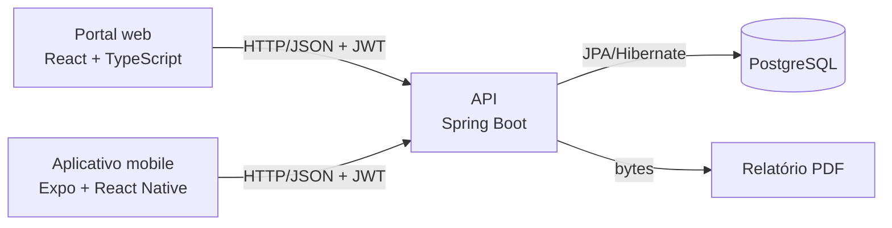
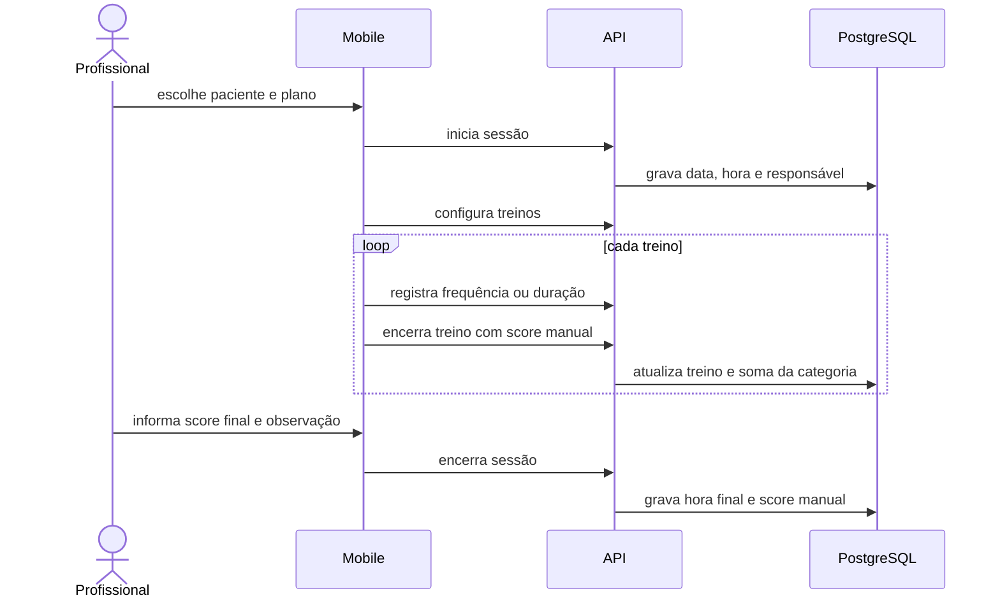

# Arquitetura

## Visão geral

| Componente | Responsabilidade |
|---|---|
| `web/` | Administração, cadastro, planejamento, histórico, edição e exportação. |
| `mobile/` | Consulta em sala, configuração e execução do atendimento. |
| `backend/` | Autenticação, autorização, regras de negócio, persistência e PDF. |
| PostgreSQL | Persistência relacional de profissionais, pacientes, planos, sessões e resultados. |
| Docker Compose | Orquestra banco, backend e portal para desenvolvimento local. |

## Backend

O backend está organizado em camadas:

- `controller`: rotas HTTP e contratos de entrada e saída.
- `service`: regras de negócio, propriedade dos recursos e transações de aplicação.
- `repository`: acesso aos dados por Spring Data JPA.
- `entity`: modelo persistido.
- `dto`: contratos que evitam expor diretamente as entidades.
- `config`: JWT, Spring Security, CORS e dados iniciais.
- `exception`: tradução centralizada de falhas de negócio e autorização.

## Autenticação

1. Cliente envia credenciais para `/api/auth/login`.
2. API valida a senha com BCrypt e emite JWT.
3. Cliente envia `Authorization: Bearer <token>` nas demais requisições.
4. `JwtAuthenticationFilter` valida o token antes dos controllers.
5. A aplicação é stateless; não depende de sessão HTTP no servidor.

## Fluxo de atendimento

## Execução local

- Web: porta `3000` no host, servida por Nginx no contêiner.
- Backend: porta `8080`.
- PostgreSQL: porta `5432`.
- Metro/Expo: normalmente porta `8081`, executado fora do Compose.

O IP usado pelo mobile depende da rede do desenvolvedor e não deve ser versionado como configuração universal.
