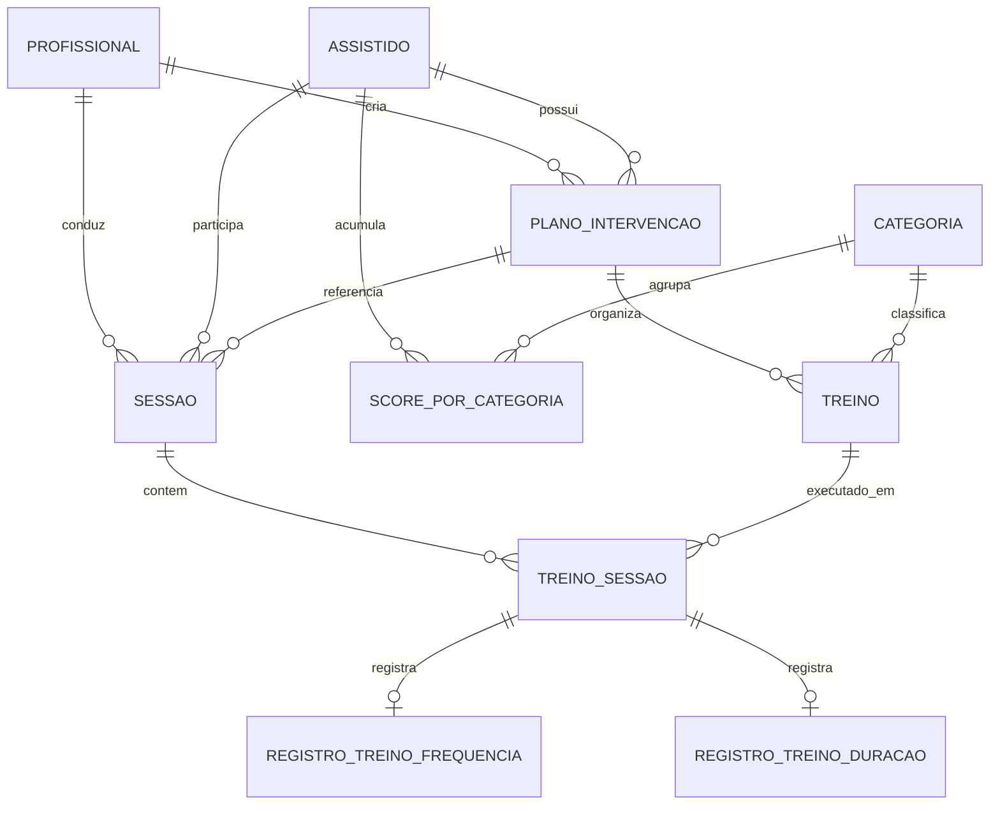

# Modelo de dados

O backend utiliza JPA/Hibernate com PostgreSQL. Este modelo foi extraído das entidades atuais e substitui, para fins técnicos, o diagrama de classes anterior enviado pela equipe. Nomes físicos podem variar conforme a estratégia do Hibernate.

## Dicionário resumido

| Entidade | Finalidade | Campos relevantes |
|---|---|---|
| `Profissional` | Identidade autenticada. | id, CPF único, nome, e-mail único, senha com hash. |
| `Assistido` | Cadastro do paciente. | id, CPF único, nome, nascimento, convênio, sala, período, frequência e responsável. |
| `PlanoIntervencao` | Plano clínico de um paciente. | nome, objetivo, criação, status, criador e assistido. |
| `Categoria` | Classificação do treino. | id e nome único. |
| `Treino` | Atividade planejada. | nome, objetivo, atividade, medição, categoria e plano. |
| `Sessao` | Atendimento realizado. | profissional, plano, assistido, data, horários, score final e observações. |
| `TreinoSessao` | Execução de um treino na sessão. | treino, sessão, score inteiro e observações. |
| `RegistroTreinoFrequencia` | Contadores de execução. | sem ajuda, com ajuda e não executado. |
| `RegistroTreinoDuracao` | Tempo medido. | duração em segundos. |
| `ScorePorCategoria` | Soma histórica por paciente e categoria. | assistido, categoria e valor acumulado. |

## Integridade observada

- Relacionamentos obrigatórios usam chaves estrangeiras não nulas quando indicado nas entidades.
- Unicidade está declarada para CPF e e-mail do profissional, CPF do paciente e nome da categoria.
- `ScorePorCategoria.valor` é `Double` por legado, embora os novos scores de treino sejam inteiros.
- O esquema é atualizado por `spring.jpa.hibernate.ddl-auto=update` no Compose; migrações versionadas ainda não existem.
